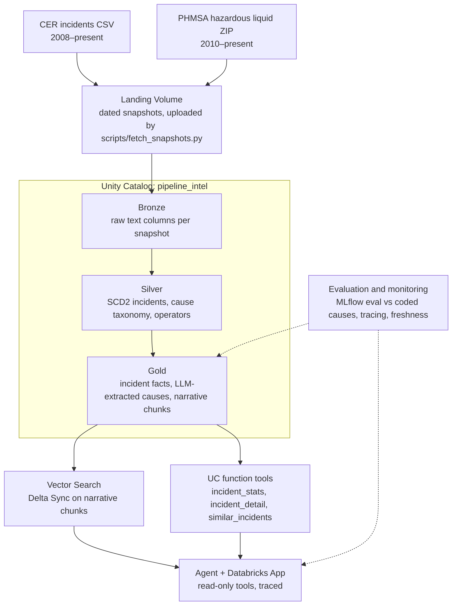

# Project plan — Pipeline Incident Intelligence

One governed lakehouse on Databricks Free Edition that ingests Canadian (CER) and US (PHMSA) pipeline incident data, reconciles both into one model, classifies incident narratives into a common cause taxonomy with an LLM, scores that classification against the regulators' own coded causes, and serves an evaluated agent that answers pipeline-integrity questions.

Status and session notes live in `CLAUDE.md`. This file is the plan; tick boxes as work lands.

## Why this design

- **Two regulators, two schemas.** CER and PHMSA describe the same kinds of events with different columns, units and cause codes: a real conformance and reconciliation problem.
- **Ground truth for the LLM.** CER publishes coded immediate and basic causes; PHMSA publishes a free-text `narrative` plus coded `cause` / `cause_details`. The LLM classifies PHMSA narratives into the CER cause taxonomy, and PHMSA's own codes (mapped to that taxonomy) score it.
- **Data that changes.** CER is republished regularly; dated snapshots (live + Internet Archive captures) give real snapshot-diff CDC and SCD2.

## Architecture

## Data sources

| Source | Coverage | Format | Licence | Role |
| --- | --- | --- | --- | --- |
| [CER: Incidents at CER-regulated pipelines and facilities](https://open.canada.ca/data/en/dataset/fd17f08f-f14d-433f-91df-c90a34e1e9a6) | 2008 to present | CSV, windows-1252, 16 columns | Open Government Licence – Canada | Canadian facts; coded immediate and basic causes (the target taxonomy) |
| [PHMSA hazardous liquid accidents, Jan 2010 to present](https://www.phmsa.dot.gov/data-and-statistics/pipeline/distribution-transmission-gathering-lng-and-liquid-accident-and-incident-data) | 2010 to present | ZIP: tab-delimited TXT (~650 columns) + field description | US public data | Narratives for extraction and retrieval; coded causes for evaluation |

PHMSA includes personal contact fields (`preparer_*`, `local_contact_*`, `authorizer_*`). They stay in Bronze only: Silver selects explicit columns, and they are never embedded or sent to an LLM.

## Data model

| Layer | Table | Grain | Notes |
| --- | --- | --- | --- |
| Bronze | `bronze.cer_incident_raw`, `bronze.phmsa_liquid_raw` | One row per source row per snapshot | All text; `_snapshot_date`, `_source_file`, `_ingested_at`, `_rescued_data` |
| Silver | `silver.cer_incident`, `silver.phmsa_incident` | One row per incident per version (SCD2) | Typed, normalized before diffing so format changes are not history |
| Silver | `silver.cause_taxonomy` | One row per source cause code | Maps CER and PHMSA codes to one taxonomy; a documented modelling decision |
| Silver | `silver.operator` | One row per resolved operator | Entity resolution across regulators |
| Gold | `gold.incident_fact` | One row per incident, both regulators | Units converted (barrels to m³), dates and locations aligned |
| Gold | `gold.incident_cause_extracted` | One row per incident per prompt version | Cause, sub-cause, equipment, mechanism, confidence, model and prompt version |
| Gold | `gold.incident_chunk` | One row per narrative chunk | Text plus metadata columns used as Vector Search filters |
| Ops | `ops.extraction_eval`, `ops.agent_eval` | One row per run | Accuracy against coded causes; agent answer scores |
| Ops | `ops.source_freshness` | One row per source per check | Expected cadence vs last seen |

## Build plan

- [x] **Week 0 — spike.** Sources confirmed and profiled; catalog, schemas and landing Volume created. Still open: does `ai_query` reach a pay-per-token model in this workspace?
- [x] **Week 1 — ingest to Bronze.** Asset Bundle, local fetch script with Internet Archive history, Auto Loader pipeline, acceptance checks. CER: 5 snapshots (2022-09-14 to 2026-10-30). PHMSA: 6,052 rows.
- [x] **Week 2 — Silver and CDC.** Explain the 2024-09-04 change spike (check 5), normalize those columns, then SCD2 from snapshots (`create_auto_cdc_from_snapshot_flow`, `stored_as_scd_type=2`). Expectations on dates, units and nulls. Report on deleted or re-keyed incidents.
- [ ] **Week 3 — conformance and reconciliation.** Cause taxonomy mapping, unit conversion, operator resolution. Reconcile counts by year and province/state against the regulators' published summaries.
- [ ] **Weeks 4–5 — LLM extraction.** `ai_query` over PHMSA narratives into a JSON schema checked by deterministic validators; model and prompt version on every row; incremental re-runs only.
- [ ] **Weeks 5–6 — extraction evaluation.** Extracted vs coded cause; confusion matrix; one MLflow run per prompt version; the accuracy figure is the headline number.
- [ ] **Weeks 6–7 — retrieval.** Chunk narratives with metadata; one Vector Search index with Delta Sync on `gold.incident_chunk`.
- [ ] **Weeks 7–9 — agent.** Agent Framework agent with Unity Catalog function tools; read-only; MLflow tracing; 40–60 evaluation questions scored with MLflow evaluation.
- [ ] **Weeks 9–10 — app and monitoring.** Databricks App for chat and browsing; source-freshness checks with an alert.
- [ ] **Weeks 10–11 — publish.** README with architecture, evaluation numbers and design decisions; walkthrough video; write-up.

## Risks and fallbacks

- **Daily compute quota.** Small incremental batches; scope extraction to liquids from 2015 if needed.
- **No foundation model via `ai_query`.** Run extraction locally with the Claude API and load results as a table; evaluation design unchanged.
- **Format changes between snapshots.** Normalize in Silver before diffing so SCD2 records real changes only.
- **Non-commercial terms.** Free Edition is for personal, non-commercial use.
